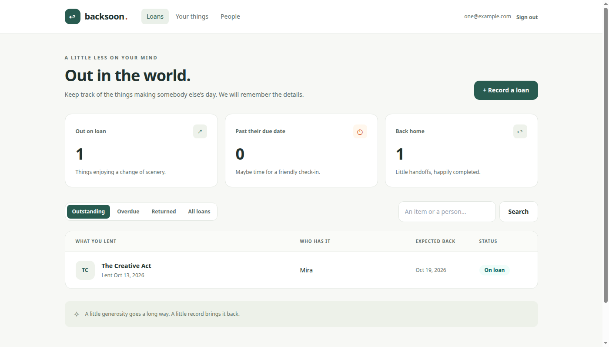

# Backsoon

**Remember what you lent, who has it, and when it’s coming back.**

A private lending tracker built with Ruby on Rails. Lend a book, share a charger, or send your tools on a little adventure—and keep a record of the handoff.



## What you can do

- Create an account and sign in to your own private notebook.
- Add and edit your items and the people you lend to.
- Record a loan with lending and expected return dates, plus an optional note.
- Browse outstanding, overdue, returned, or all loans.
- Search by item or borrower, with paginated results.
- Mark an item returned and preserve its lending history.
- Lend returned items again, while preventing two active loans for the same item.
- Request a password reset. Messages are saved locally by default; development and production can deliver through SMTP.

Your data lives in SQLite and survives application restarts. SQLite needs no online account, API key, or separate database server. Borrower email addresses are private contact notes; Backsoon does not send borrowers reminders.

## Run locally

Requires **Ruby 3.4.11** and Bundler. Rails **8.1.4**, SQLite, and Tailwind are installed as project gems. Node.js and npm are not needed.

With [mise](https://mise.jdx.dev/):

```sh
git clone https://github.com/arnavsx3/backsoon.git
cd backsoon
mise trust
mise install
make setup
make dev
```

Open **http://localhost:3000** and create an account. Add an item under **Your things**, add a borrower under **People**, then choose **Record a loan**. There is no default account or shared password.

If Ruby is already on your PATH, mise is optional. The Makefile uses it when available; the ordinary Rails commands work directly:

```sh
bin/setup --skip-server
bin/dev
```

Ctrl+C stops the development server and Tailwind watcher. Ruby source reloads in development; Tailwind rebuilds as you edit styles and views.

## Tech stack

| Technology | Purpose |
| --- | --- |
| Ruby + Rails | Models, validations, controllers, routing, and ERB pages |
| Active Record + SQLite | Persistent records, migrations, indexes, and ownership constraints |
| Hotwire: Turbo | Browser navigation and form submissions |
| Tailwind CSS | Responsive layouts and shared interface styles |
| Puma | HTTP application server |
| Solid Queue + Solid Cache | Production background jobs and cache, backed by SQLite |
| Minitest + Capybara + Selenium | Model, request, and real-browser tests in Ruby |
| RuboCop + HTMLBeautifier | Ruby and ERB formatting |
| Brakeman + dependency audits | Static security and dependency checks |
| GitHub Actions | Automated checks on pushes and pull requests |

## Repository structure

```text
app/
├── models/                 # Users, sessions, items, borrowers, loans
├── controllers/            # Account-scoped requests and return actions
├── views/                  # ERB screens and shared partials
├── helpers/                # Display labels, dates, navigation
├── assets/tailwind/        # Tailwind theme and reusable styles
├── javascript/             # Turbo import
└── mailers/                # Password recovery messages
bin/                        # Setup, development, checks, and Rails commands
config/                     # Routes, environments, database, jobs, and CSP
db/                         # Versioned migrations and schemas
docs/                       # Architecture, development, deployment, screenshots
test/                       # Models, requests, fixtures, browser scenarios
storage/                    # Local SQLite files (ignored)
```

## Checks

```sh
make check   # Setup, formatting, audits, static analysis, application tests
make e2e     # Real-browser scenarios
make format  # Apply Ruby and ERB formatting
```

Browser tests require Chrome or Chromium. Selenium Manager resolves the test browser and driver, downloading them if needed. Set `CHROME_BIN=/path/to/chrome` to use a specific browser executable.

## Learn the codebase

Start with [architecture](docs/architecture.md), then read `Loan`, its migration, and the model tests together. Controllers scope every record to the signed-in user; the database also prevents cross-account references and simultaneous active loans. Returns preserve the first recorded return date.

See [development](docs/development.md) for commands, local password-reset messages, and configuration. See [deployment](docs/deployment.md) for persistent storage, secrets, HTTPS, background workers, and mail delivery. The repository includes a production Dockerfile; no hosted deployment is configured.
