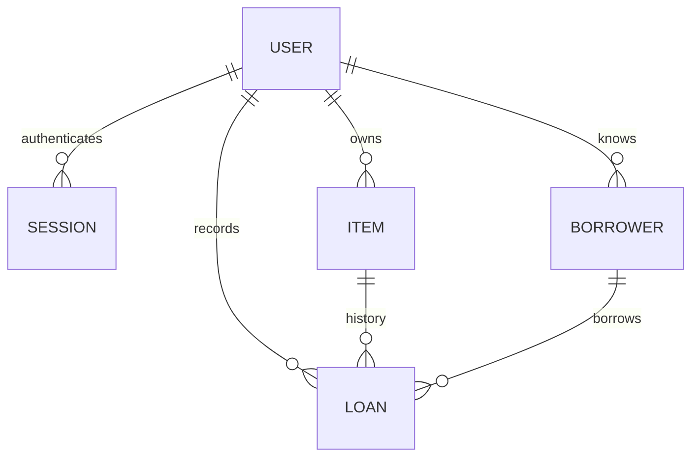

# Architecture

Backsoon follows Rails’ model-view-controller layout. Ruby owns application behavior, ERB renders pages, Turbo enhances ordinary links and forms, and SQLite stores records. There is no separate frontend application or JSON API.

## Responsibilities

- `User`, `Session`, `Current`, and the `Authentication` concern build on Rails’ authentication generator. Registration adds account creation and validation.
- `Item` owns descriptive details and its lending history. `Borrower` owns contact notes and their loan history.
- `Loan` owns date validation, ownership consistency, status, search, and the return transition.
- Controllers find records through `Current.user.items`, `.borrowers`, or `.loans`. Submitted user IDs and return dates are not mass assignable.
- `LoanReturnsController` represents the return action as a nested resource; it delegates the state transition to the model.
- `Paginatable` bounds lists to 20 records per page. Controllers preload related items and borrowers used by the views.
- Helpers format presentation details. Shared ERB partials handle headings, validation errors, empty states, pagination, and history.

## Invariants and persistence

Ruby validations produce useful form errors. SQLite independently enforces important invariants:

1. A partial unique index on `loans.item_id`, where `returned_on IS NULL`, allows at most one outstanding loan per item. It also protects concurrent requests that both pass validation.
2. Composite foreign keys pair the item or borrower ID with the loan’s user ID. A loan cannot refer to another account’s records, even if application validation is bypassed.
3. Check constraints require the due date and return date to be on or after the lending date. Required fields and foreign keys remain database constraints.
4. Items and borrowers with history cannot be deleted. The model explains this restriction and the foreign keys protect references.

An overdue loan is outstanding with `due_on < Date.current`. An item due today is not overdue. There is no scheduler updating statuses; the current date determines the result of each query.

`Loan#return!` reloads within a locked transaction and records today only when the loan is outstanding. Repeated return requests preserve its original return date. A returned item can be lent again, creating a new history record.

Dates use the configured application timezone, defaulting to UTC. SQLite persists in `storage/`; a process restart does not erase records. Production uses separate SQLite files for primary data, Solid Queue, and Solid Cache.

## Account boundaries

Every lending controller requires authentication. Record lookup is scoped to the current user, including item and borrower IDs submitted in a loan form. Cross-account access returns 404. Views escape user content, forms use Rails’ CSRF protection, and the application has a nonce-based content security policy compatible with import maps and Turbo.

Password reset responses do not disclose whether an address exists. Successful resets revoke existing sessions and invalidate the old reset token. Development and production save messages locally by default, with optional SMTP delivery.

## Test organization

- `test/models`: date rules, literal search, return idempotency, availability, validation, and database constraints.
- `test/controllers`: authentication, account ownership, CRUD, filters, pagination, escaped output, and invalid forms.
- `test/system`: a complete lending cycle, editing, empty-state guidance, mobile overflow, and desktop navigation.

Fixtures use two distinct accounts to make ownership failures visible. Tests run against a separate SQLite database and do not alter development records.
